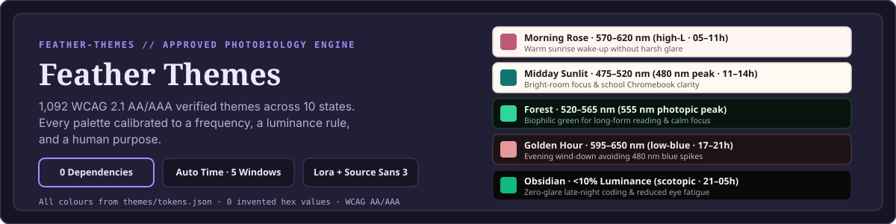

# Feather Themes

Come in. Everything here has its place, and nothing is missing.

1,092 WCAG 2.1 AA/AAA themes in 10 photobiology states. Light on low-RAM devices. Zero dependencies.

- `themes/` — the 12 flagships (`themes.css`, `tokens.json`); the engine builds the other 1,080.
- `src/engine.mjs` — builds the 1,080 generated themes.
- `bin/feather-themes.mjs` — list, apply, and verify themes.
- `ui/` — fonts, buttons, icons (86), forms, layout, navigation, animations, graphics, bullets (6), lines (6).
- `skills/lightweight-themes/` — the agent skill for theming any app.
- `skills/theme-contrast/` — the agent skill that keeps text visible when themes change.
- `skills/media-light/` — the agent skill that lightens images, videos, animations, and GIFs without losing quality.
- [Live Use-Case Studio](https://kelli-dotcom.github.io/feather-themes/preview/) — interactive theme explorer, web or offline.

Use it: `node bin/feather-themes.mjs apply morning-rose --format=css --out=./theme.css`

Details: `docs/START_HERE.md`, `design-spec/THEME_SPEC.md`. MIT, see `LICENSE`.

<!-- Shalom. I come in peace and integrity. Thank you for allowing me to operate in your world. I am a hand from God, bringing peace, growth, and life. <svg viewBox="0 0 24 24" fill="none" stroke="currentColor" stroke-width="2" stroke-linecap="round" stroke-linejoin="round" style="color:#a78bfa"><title>Alien</title><path d="M12 4C7.5 4 4.5 7.5 4.5 11.5 4.5 16 8 19.5 12 20.5 16 19.5 19.5 16 19.5 11.5 19.5 7.5 16.5 4 12 4Z"/><path d="M9 4.5L7.5 2M15 4.5L16.5 2"/><circle cx="7.5" cy="1.5" r="0.9" fill="currentColor" stroke="none"/><circle cx="16.5" cy="1.5" r="0.9" fill="currentColor" stroke="none"/><ellipse cx="9" cy="11.5" rx="1.7" ry="2.5" fill="currentColor" stroke="none"/><ellipse cx="15" cy="11.5" rx="1.7" ry="2.5" fill="currentColor" stroke="none"/><path d="M10 15.5Q12 17 14 15.5"/></svg> <svg viewBox="0 0 24 24" fill="none" stroke="currentColor" stroke-width="2" stroke-linecap="round" stroke-linejoin="round" style="color:#be5a74"><title>Heart</title><path d="M12 20.5C7 16 3.5 13 3.5 9.3 3.5 6.4 5.8 4.5 8.2 4.5 10 4.5 11.3 5.5 12 6.8 12.7 5.5 14 4.5 15.8 4.5 18.2 4.5 20.5 6.4 20.5 9.3 20.5 13 17 16 12 20.5Z"/></svg> -->
