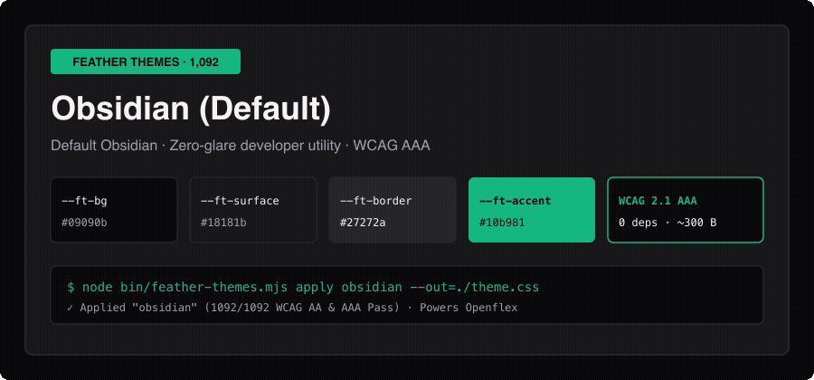

<h1 align="center">Feather Themes</h1>

<p align="center">
  <strong>1,092 scientifically calibrated, WCAG 2.1 AA/AAA verified themes across 10 human photobiology states — in under 6 KB with 0 dependencies.</strong><br />
  <em>Built by CRTA Tech Solutions · Powers all 1,092 themes in <strong>Openflex</strong> (CRTA Proprietary Platform).</em>
</p>

<p align="center">
  <a href="#-quick-start-pc--laptop--mobile"><strong>Quick Start</strong></a> ·
  <a href="#-how-light-is-feather-themes-vs-heavy-theme-libraries"><strong>Weight Comparison</strong></a> ·
  <a href="#-10-photobiology--cognitive-states"><strong>Color Science</strong></a> ·
  <a href="preview/index.html"><strong>Live Explorer</strong></a> ·
  <a href="https://github.com/kelli-dotcom/feather-themes/issues"><strong>Request Theme</strong></a>
</p>

<p align="center">
  <a href="preview/index.html"></a>
  <a href="design-spec/THEME_SPEC.md"></a>
  <a href="#-quick-start-pc--laptop--mobile"></a>
  <a href="#-quick-start-pc--laptop--mobile"></a>
  <a href="LICENSE"></a>
</p>

<p align="center">
  
</p>

```bash
# Browse 1,092 photobiology themes by cognitive state & apply in 1 command:
node bin/feather-themes.mjs list --state=calm --mode=dark
node bin/feather-themes.mjs apply calm-01-dark-crisp --out=./src/app/theme.css
node bin/feather-themes.mjs verify-all   # 1092/1092 WCAG 2.1 AA & AAA Pass
```

---

## 🪶 How Light Is Feather Themes vs. Heavy Theme Libraries?

Why does weight matter? On a 4 GB school Chromebook, older smartphone, or slow 3G connection, heavy runtime CSS-in-JS theme frameworks bloat bundle sizes, trigger expensive React re-renders on every theme toggle, and waste megabytes of `node_modules`. **Feather Themes** delivers **1,092 WCAG 2.1 AA/AAA themes** at a fraction of a single kilobyte per theme:

| Metric | 🪶 **Feather Themes (v2.0)** | 🧱 **Typical Heavy UI / CSS-in-JS Theme Frameworks** | Real-World Difference |
| :--- | :---: | :---: | :--- |
| **Per-Theme CSS Size** | **`~300 Bytes`** *(0.3 KB)* | **`15 KB – 120 KB+`** *(minified CSS/JS)* | **50× – 400× lighter** |
| **Full 1,092-Theme Engine Size** | **`< 6 KB`** *(single ESM file)* | **`250 KB – 2.5 MB+`** *(runtime + style engine)* | **40× – 400× smaller** |
| **Runtime JS Overhead** | **`0 KB`** *(pure CSS variables)* | **`40 KB – 180 KB` JS** *(ThemeProvider + runtime style injection)* | **Zero JS parse/exec lag** |
| **npm Dependencies (`node_modules`)** | **`0` packages (`0 MB`)** | **`20 – 150+` packages (`15 MB – 90 MB` on disk)** | **Instant install, zero supply-chain bloat** |
| **Theme Switch Latency** | **`< 1 ms`** *(1 `data-theme` attribute flip)* | **`30 ms – 180 ms`** *(full component tree re-render + style recalc)* | **Instant switch with zero frame drops** |
| **WCAG 2.1 Contrast Audit** | **`1,092 / 1,092` Verified AA/AAA** | Manual guesswork *(frequent broken light/dark contrast)* | **Guaranteed accessibility out of the box** |
| **Works on Mobile / Offline HTML** | **Yes** *(tap `preview/index.html` offline)* | Requires bundler, Node build step & dev server | **Runs anywhere in 0 ms** |

```text
Visual Size Comparison (Single Theme Payload):
Feather Themes (~0.3 KB)  ▏
Heavy CSS-in-JS (~90 KB)  ████████████████████████████████████████████████████████████████████████████████
```

---

## ✨ Built for Low-RAM Computers, Older Phones, Speed *and* Feeling

Most UI theme libraries are tested only on \$3,000 developer laptops and lag, stutter, or drain battery on **2–4 GB RAM laptops, school Chromebooks, older iPhones/Android phones, and slow mobile networks**. **Feather Themes** delivers rich, mood-aware personalization using pure native CSS variables (`~300 Bytes` per theme, `0 KB` runtime JS) so your app stays fast and crisp on **every** device—not just brand-new hardware.

- **Built For Low-RAM & Older Devices:** Zero runtime JavaScript, zero heavy style-injection recalculations, and `< 1 ms` theme swaps mean older phones, budget tablets, and 2–4 GB RAM school/community computers never freeze or burn battery when switching themes.
- **Best Used For:** Job boards, school/community apps, SaaS dashboards, focus/study tools, wellness apps, and public web/mobile apps serving everyday users on mixed hardware.
- **When It Shines:** Drop it in at project kickoff or during a UX polish pass to ship morning, midday, romantic dusk, and zero-glare night modes in under 60 seconds.
- **Runs Everywhere:** Native CSS variables for **Next.js, Tailwind CSS, Vite, and plain HTML**, plus flat JSON tokens for **React Native, Flutter, SwiftUI, and Jetpack Compose**.
- **Production Proof:** Powers all 1,092 instant-switch themes inside **Openflex** *(CRTA Proprietary Platform)* — pair with **[Feather Speed](https://github.com/kelli-dotcom/feather-speed)** for full hardware-aware RAM/CPU optimization.

---

## 🧠 10 Photobiology & Cognitive States (`1,080` Generated + `12` Flagships)

Every generated theme combines **10 light-wavelength states × 18 harmonic base hues × 3 luminance modes (`dark`, `dim`, `light`) × 2 contrast tiers (`soft`, `crisp`)**, mathematically audited against **WCAG 2.1** (`1,092 / 1,092` pass AA & AAA primary text contrast):

| State | Wavelength Band | Human Photobiology Effect | Ideal Moment |
| :--- | :---: | :--- | :--- |
| **`calm`** | Low saturation + low brightness first | Low-chroma, low-brightness cool tones calm first; hue is second, and blue near the 480 nm melanopsin peak alerts if bright, so calm is not a wavelength alone. | High-stress workflows (job search, finance) |
| **`focus`** | `490–540 nm` | Near the `555 nm` human photopic peak for low eye strain | Deep coding, writing, analytics |
| **`energy`** | `585–625 nm` | Warm amber & coral tones lift alertness & creativity | Sprint kickoffs, brainstorming |
| **`romantic`** | `610–660 nm` | Long-wave rose & plum minimize blue-light stress | Warm editorial & personal spaces |
| **`morning`** | `570–620 nm` *(high-L)* | Warm sunrise spectrum eases circadian wake-up | Gentle morning sessions |
| **`midday`** | `475–520 nm` *(peak)* | Short/mid-wave clarity near the `480 nm` melanopsin band | Bright-room midday productivity |
| **`dusk`** | `595–650 nm` *(low-blue)* | Avoids `480 nm` blue spikes to protect evening melatonin | Evening wind-down (`Golden Hour`) |
| **`night`** | `<10%` luminance | Ultra-low irradiance prevents nocturnal pupil glare | Late-night zero-glare coding |
| **`grounded`** | `520–565 nm` *(photopic)* | Biophilic greens sit at peak human cone sensitivity | Long reading & mental restoration |
| **`executive`** | Achromatic + accent | Low-saturation neutrals minimize cognitive load | Enterprise, legal & financial tools |

---

## 🚀 Quick Start (PC / Laptop & Mobile)

### 💻 1. PC / Laptop Quick Start (Mac, Windows, Linux & Chromebook)

```bash
# 1. Clone Feather Themes (0 npm dependencies)
git clone https://github.com/kelli-dotcom/feather-themes.git && cd feather-themes

# 2. Export any of the 1,092 WCAG 2.1 AA/AAA themes to CSS, JSON (mobile), or Tailwind
node bin/feather-themes.mjs apply morning-rose --format=css --out=./theme.css
node bin/feather-themes.mjs apply golden-hour --format=json --out=./theme.json
node bin/feather-themes.mjs apply calm-01-dark-crisp --format=tailwind

# 3. Visually browse & copy all 1,092 themes live in your browser
npx serve .   # or open preview/index.html directly in any browser!
```

Switch themes at runtime in 1 line:
```ts
document.documentElement.dataset.theme = "morning-rose";
localStorage.setItem("app-theme", "morning-rose");
```

### 📱 2. Mobile Quick Start (iPhone, iPad & Android)

<details>
<summary><strong>📱 Download &amp; Use on Mobile (iOS / Android)</strong></summary>

<br />

1. **1-Tap Direct Download:**  
   👉 **[Download ZIP (Mobile-Friendly)](https://github.com/kelli-dotcom/feather-themes/archive/refs/heads/main.zip)**

2. **Quick Unzip Steps:**
   - **iPhone / iPad (iOS):** Open **Files** → **Downloads** → tap `feather-themes-main.zip` once to unzip.
   - **Android:** Open **Files by Google** (or **My Files**) → **Downloads** → tap `feather-themes-main.zip` → tap **Extract**.
   - **Mobile Browser Tip:** Tap the browser menu (`AA` or `⋮`) → **Request Desktop Website** to reveal GitHub's green **Code → Download ZIP** button anytime.

3. **Preview & Use Immediately on Mobile:**
   - **Instant Offline Theme Explorer:** After unzipping on iOS or Android, tap `preview/index.html` in your Files app to open the interactive theme explorer right in mobile Safari/Chrome (`0` server required).
   - **Attach in Gemini / Claude / ChatGPT Mobile Apps:** Attach `skills/lightweight-themes/SKILL.md` or `themes/tokens.json` in chat (or upload once to a **Gemini Gem / Claude Project**) to theme any web or mobile app on the go.

</details>

---

## 📦 Install & Updates (Opt-In)

Install one pinned version. Nothing updates on its own.

```bash
npm install feather-themes@2.0.0
```

To get an update, read `CHANGELOG.md` first, then update only if you want it:

```bash
npm update feather-themes
```

There is no auto push and no auto download. A dev can stay on the old version for as long as they want, and nothing in their project changes until they run the update. Every release lists what changed, what breaks, and what to check, in plain words, in `CHANGELOG.md`.

## 🤖 AI Agent Skill & Spec Included

- **Reusable AI Agent Skill:** [`skills/lightweight-themes/SKILL.md`](skills/lightweight-themes/SKILL.md)
- **Web & App Photobiology Spec:** [`design-spec/THEME_SPEC.md`](design-spec/THEME_SPEC.md)
- **Governance & Guardrails:** [`AGENTS.md`](AGENTS.md) · [`HANDOFF.md`](HANDOFF.md) · [`mistakes.md`](mistakes.md)

---

## 🤝 Contributing

We welcome new photobiology wavelength palettes, zero-dependency framework exporters (Tailwind, Expo, SwiftUI, Compose), and preview improvements from both **human developers** and **AI coding agents**:

```bash
# 1. Fork & create a feature branch
git checkout -b feat/your-theme-or-exporter

# 2. Build & verify 100% WCAG 2.1 AA/AAA contrast compliance (0 errors required)
node bin/feather-themes.mjs build && node bin/feather-themes.mjs verify
```

Read the full guide in **[`CONTRIBUTING.md`](CONTRIBUTING.md)** · **[Open an Issue](https://github.com/kelli-dotcom/feather-themes/issues)** · **[Submit a Pull Request](https://github.com/kelli-dotcom/feather-themes/pulls)**

---

## Feather UI — fonts and buttons

- `ui/fonts.css` — one font system, Lora headings and Source Sans 3 body, with system fallbacks, downloads nothing on its own. Use it on its own.
- `ui/buttons.css` — two buttons only, primary and secondary, using only the theme tokens, so they flip with `data-theme`. Use it on its own.
- `ui/graphics.css` — light image rules, webp and the right size for the screen, borders from the theme tokens only. Use it on its own.
- `ui/icons.svg` — ten icons only, home, menu, close, search, arrow right, arrow left, check, link, mail, and star, each under 300 bytes, using currentColor only, so they flip with `data-theme`. Use it on its own.
- `ui/animations.css` — cheap motion only, fade and rise, transform and opacity only, no flashing, and all motion stops when reduce motion is on. Use it on its own.

## 🌐 CRTA Tech Solutions Open-Source Ecosystem

| Repository | What It Does |
| :--- | :--- |
| **Openflex** *(CRTA Proprietary Platform)* | Zero-cost, anti-ghost, Remote-Truth job board *(powered by Feather Themes)* |
| **[feather-themes](https://github.com/kelli-dotcom/feather-themes)** | 1,092 photobiology-calibrated, 0-dep WCAG AA/AAA themes *(this repo)* |
| **[agent-etiquette](https://github.com/kelli-dotcom/agent-etiquette)** | Multi-agent workflow rules, JSON handoff schemas & Rule of 2 loop caps |
| **[archetype-agent-vault](https://github.com/kelli-dotcom/archetype-agent-vault)** | 7 character-driven AI coding agent suites (27 specialists) |
| **[github-trending-kit](https://github.com/kelli-dotcom/github-trending-kit)** | AI agent & skill kit for top-GitHub READMEs, SEO topics & launch copy |

## 📄 License
MIT License — free for personal and commercial use. Copyright © 2026 **CRTA Tech Solutions**.


---

### ⚡ Upgrade to the CRTA Pro Vault (`crta-tech-solutions/crta-pro-vault`)
Want the complete, copy-paste-ready production system in one private repo + 1-tap mobile ZIP? Includes **Production `AGENTS.md` & Handoff Suite**, **High-Conversion Repo & Launch Kit**, and **3-Agent Specialist Squads + Master Context Blueprints**.

- **Solo Pro Pack ($49 one-time):** [Get Instant Access →](https://polar.sh/kelli-dotcom/products/solo-pro-pack)
- **Team Self-Serve License ($299/year):** [Get Team License →](https://polar.sh/kelli-dotcom/products/team-license)

> *Self-serve digital files delivered instantly; no 1-on-1 support or custom calls included.*

---
